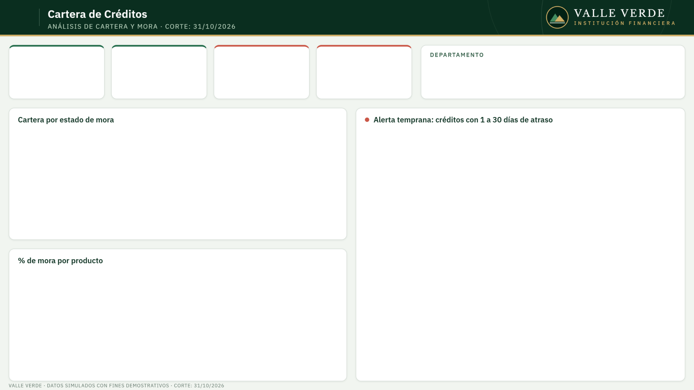

# Alerta temprana de mora — Cooperativa Valle Verde

Proyecto de análisis de cartera de créditos que identifica a los clientes que empiezan a atrasarse en sus pagos, para que el área de cobranza pueda gestionarlos antes de que la mora se agrave.

> **Nota:** Valle Verde es una institución ficticia. Todos los datos son simulados y se generaron con fines demostrativos.



## El problema

Los reportes tradicionales de mora muestran los créditos que ya están atrasados. Para cobranza, lo más valioso es saber a quién llamar primero: los créditos con pocos días de atraso y mucho saldo en riesgo, que todavía son recuperables.

## Herramientas

- **SQL Server:** base de datos, consultas de análisis y vista para reportes
- **Power BI:** tablero interactivo con medidas DAX
- **Python (pandas, pyodbc):** generación automática de la lista de alerta en Excel

## Datos

| Tabla | Filas | Contenido |
|---|---|---|
| clientes | 400 | Datos del cliente: departamento, ocupación, ingreso |
| creditos | 595 | Producto, monto, plazo, tasa y fecha de desembolso |
| cuotas | 11,448 | Plan de pagos: vencimiento, monto y fecha de pago |

Fecha de corte del análisis: 31/10/2026.

## Qué incluye

**Análisis en SQL** (`sql/02_analisis_mora.sql`)

1. Mora por tramos de días de atraso (1–30, 31–60, 61–90, más de 90)
2. Índice de mora de la cartera, general y por producto
3. Lista de alerta temprana: créditos con 1 a 30 días de atraso, ordenados por saldo en riesgo
4. Señales de deterioro: clientes al día cuyas últimas tres cuotas se pagaron con retraso
5. Análisis de cosechas por trimestre de desembolso

Técnicas usadas: `JOIN` y `LEFT JOIN`, CTE, `CASE`, `HAVING`, funciones de ventana (`ROW_NUMBER`), vistas.

**Tablero en Power BI** (`powerbi/alerta_mora_valle_verde.pbix`)

- Indicadores: cartera total, cartera en mora, % de mora y créditos en mora
- Cartera por estado de mora y % de mora por producto
- Tabla de alerta temprana con filtro por departamento

**Automatización en Python** (`python/alerta_mora.py`)

Se conecta a SQL Server, extrae la lista de alerta, clasifica cada crédito por prioridad (alta, media, baja) y genera un archivo de Excel con la fecha del día.

## Resultados principales

- La cartera total es de L 20.29 millones, con 29.07 % en mora (107 créditos).
- Microempresa es el producto con más riesgo: 41.25 % de su cartera está en mora, casi el doble que Vivienda (21.01 %).
- El tramo de más de 90 días tiene el 31 % de los créditos en mora, pero concentra el 68 % del monto vencido.
- Hay 34 créditos en etapa temprana (1 a 30 días) con L 1.87 millones de saldo en riesgo; 7 de ellos son de prioridad alta.
- Se detectaron 8 créditos al día con señales de deterioro, que no aparecen en ningún reporte de mora.

Los resultados se validaron entre las tres herramientas: SQL, Power BI y Python devuelven los mismos totales.

## Cómo reproducirlo

1. Ejecutar `sql/01_crear_base_valle_verde.sql` en SQL Server Management Studio. Crea la base `ValleVerde` y carga los datos.
2. Ejecutar `sql/03_vista_estado_creditos.sql` para crear la vista.
3. Abrir el archivo `.pbix` en Power BI Desktop y actualizar la conexión al servidor local.
4. Para el script de Python:
   ```
   pip install pandas pyodbc openpyxl
   python python/alerta_mora.py
   ```
   Antes de ejecutarlo, ajustar el nombre del servidor y el controlador ODBC en el script.

## Estructura del repositorio

```
alerta-temprana-mora/
├── README.md
├── img/
│   └── dashboard.png
├── sql/
│   ├── 01_crear_base_valle_verde.sql
│   ├── 02_analisis_mora.sql
│   └── 03_vista_estado_creditos.sql
├── powerbi/
│   └── alerta_mora_valle_verde.pbix
└── python/
    └── alerta_mora.py
```

## Autora

Karen Daniela Irias Moncada — [LinkedIn](https://linkedin.com/in/karenirias) · [GitHub](https://github.com/Daniela-Irias27)
